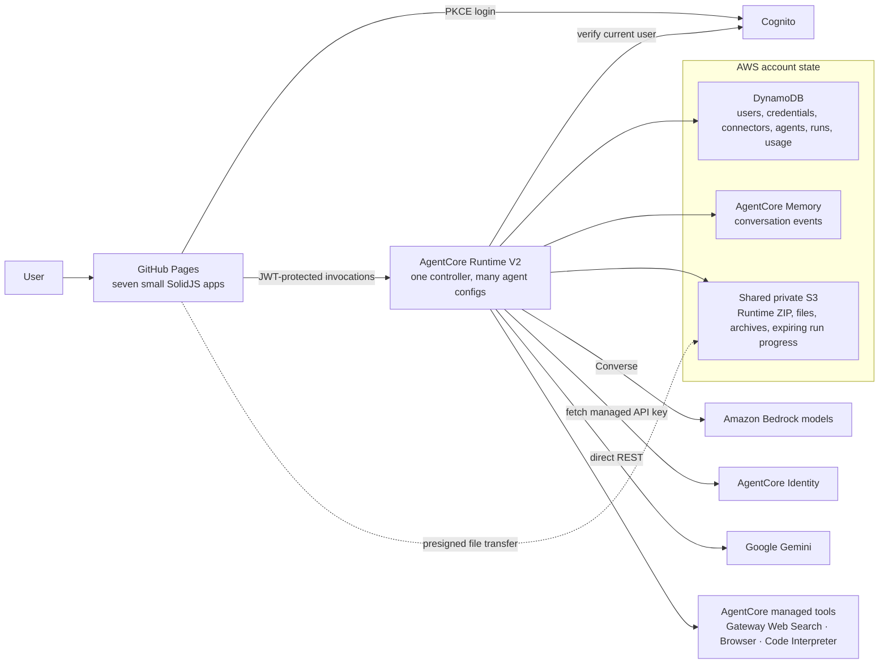

# AgentCore Chat documentation

Start here for the current contract. The implementation has seven buildless
SolidJS documents and one V2 AgentCore Runtime backed by Memory, one DynamoDB table,
and one shared S3 bucket. The Runtime is the authorization and accounting
boundary; a Runtime session is an ephemeral performance optimization, not the
owner of conversation or account state.

CloudFormation provisions the shared AWS resources. Agent and project changes
are data changes in the Runtime, not new deployments. The browser never writes
the table or reads managed credentials directly; only presigned file bytes
transfer between the page and S3.

- [ROADMAP-CUTOVER.md](ROADMAP-CUTOVER.md) is the current delivery ledger: what
  shipped, what was verified live, and what remains. Native background execution
  is implemented; automatic recovery after Runtime loss remains a future contract.
- [ARCHITECTURE.md](ARCHITECTURE.md) explains the deployed shape and local
  development loop. When older details conflict with the cutover ledger, use
  the ledger and current code.
- [TOOLS.md](TOOLS.md) describes implemented managed tools and credential
  scope. `runtime/`, page `app.js` files, `shared/`, and `tests/` are the executable
  contract; `npm test` and opt-in live stories establish behavior.

The root chat URL and OAuth callback are preserved. Profile, Users, Usage,
Agents, Connectors, and Credentials each own their entrypoint and feature data.
Shared modules provide the authenticated shell, transport, navigation, and
controls; ordinary links switch documents. Tokens and Runtime session IDs live
in deployment-isolated `sessionStorage`. Credentials are write-only inputs and
are never browser-persisted or returned on reads.

The October 10 slice passed disposable-stack validation. Its reviewed production
Runtime update completed with all 20 resource identities preserved; publication
and checks at the GitHub Pages origin follow in the same authorized rollout.
See the delivery ledger for the exact artifact and validation evidence.

`FOUNDATION.md` records an earlier release. `PLAN.md`, `API-CONTRACT.md`,
`IMPLEMENTATION.md`, `STATUS.md`, `PRODUCT-ROADMAP.md`,
`RUNTIME-DECISION.md`, and `USAGE-RESOURCES.md` are historical design or status
records, not instructions to reintroduce Lambda, Harness, or old quota rules.
